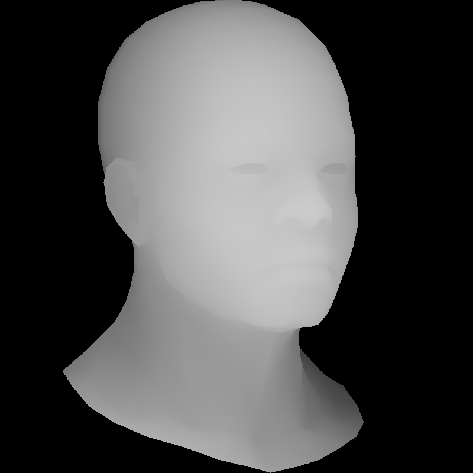
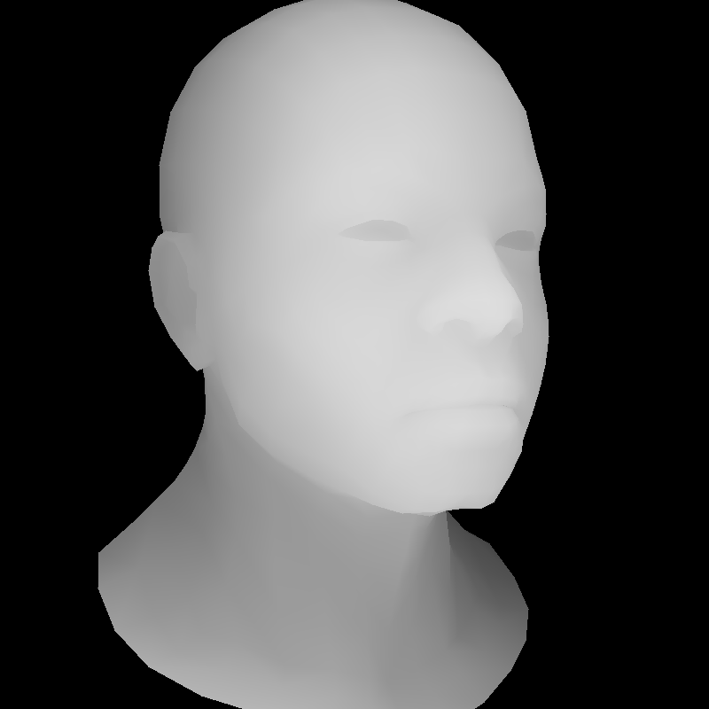

# CPU Renderer

A C17 renderer project for learning pixel, line, and triangle drawing on the CPU.
Image output uses a C adaptation of TinyRenderer's TGA utilities. No C++ compiler
or C++ runtime is required.

The project was migrated from C++ to C so learning effort could stay focused on
rasterization rather than learning an unfamiliar language alongside it.

## Building and running

Requirements: CMake 3.20 or later and a compiler with C17 support.

From the project root:

```bash
cmake -S . -B build -DCMAKE_BUILD_TYPE=Debug
cmake --build build
./build/cpu_renderer
```

The executable writes `framebuffer.tga` to its working directory. Without
arguments it draws three RGB-interpolated triangles on a 128 × 128 framebuffer.
Generated images and build directories are ignored by Git.
Each successfully saved image is reported in the terminal as `Saved image: <path>`.

Use `./build/cpu_renderer --help` (or `-h`) to list usage, mode flags, model
lookup rules, output filenames, and examples. Help exits without rendering.

The existing `build/` directory can be reconfigured with these commands after
the C migration. Reconfigure `build-release/` before using it as well.

On Windows with a multi-configuration generator:

```powershell
cmake -S . -B build
cmake --build build --config Debug
.\build\Debug\cpu_renderer.exe
```

## C API and image ownership

Images are plain structs. Initialize them to zero, allocate pixels explicitly,
and release the pixels when finished. Pass image pointers to drawing functions.
`TGAColor` stores four channels in **BGRA** order.

```c
#include "colors.h"
#include "triangle_renderer.h"

int main(void)
{
    TGAImage framebuffer = {0};
    if(!tgaImageInit(&framebuffer, 128, 128, TGA_RGB))
        return 1;

    // Counterclockwise vertices, followed by their respective colors.
    drawTriangleWithBoundingBox(7, 45, 45, 60, 35, 100,
        red, green, blue, &framebuffer);

    const bool success = tgaImageWrite(&framebuffer, "framebuffer.tga", true, true);
    tgaImageDestroy(&framebuffer);
    return success ? 0 : 1;
}
```

- `tgaImageInit` allocates black grayscale, RGB, or RGBA pixels.
- `tgaImageSet(&image, x, y, color)` writes a pixel and ignores out-of-bounds coordinates.
- `tgaImageGet(&image, x, y)` returns a pixel value.
- `tgaImageRead` supports uncompressed and RLE grayscale/RGB/RGBA TGA files.
- `tgaImageWrite` takes explicit origin and compression arguments. `true, true`
  preserves the original bottom-left origin and RLE output.
- `tgaImageDestroy` frees owned storage. An initialized image must not be shallow
  copied and then destroyed twice; use pointers when sharing it.

A grayscale sample can be written with a compound literal:

```c
uint8_t z = 128;
tgaImageSet(&zbuffer, x, y, (TGAColor){{z, 0, 0, 0}});
```

Initialize `zbuffer` with `TGA_GRAYSCALE` to store only the first channel.

## Line and triangle rendering

- `drawLineBarycentric` samples a segment at parameter increments of `0.02`.
  Long lines can have gaps.
- `drawLineInterpolated` uses integer error accumulation, supports all directions,
  and includes both endpoints. Coincident endpoints draw one pixel.
- `drawTriangleWithMyScanlineV1` computes floating-point scanline intersections.
  It requires three distinct vertex y coordinates; horizontal-edge cases are skipped.
- `drawTriangleWithMyScanlineV2` computes integer scanline intersections and excludes
  the right endpoint of each horizontal span.
- `drawTriangleWithBoundingBox` interpolates the B, G, and R channels of three
  vertex colors; output alpha is 255.
- `drawTriangleWithBoundingBoxDepth` additionally accepts three mapped depth values
  and an optional row-major `double` depth buffer pointer. This replaces the C++ overload.

The bounding-box paths skip triangles with signed area below 1 pixel squared,
including clockwise and degenerate triangles when y increases upward. Assign the
same color to all three vertices to draw a uniformly colored face.

```c
// Initialize width * height depth samples to -INFINITY.
// az, bz, and cz are unclamped mapped depths; values outside [0, 255] are valid.
drawTriangleWithBoundingBoxDepth(ax, ay, bx, by, cx, cy,
    az, bz, cz, red, green, blue, &framebuffer, zbuffer);
```

All project functions have English Doxygen comments in the headers and sources.

## Rendering OBJ models

Place models under `obj/` and run from the project root:

```bash
./build/cpu_renderer diablo3_pose.obj
./build/cpu_renderer --wireframe --orthographic diablo3_pose.obj
./build/cpu_renderer --filled --perspective obj/african_head/african_head.obj
./build/cpu_renderer obj/boggie/head.obj --filled
```

Drawing-mode and projection flags can precede or follow the model path.
Filled rendering with perspective is the default. Use one flag from each group:

- `--wireframe` or `--filled`: Draw face boundaries or filled triangles.
- `--orthographic`: Rotate, then apply only viewport mapping with `vec3Project`.
- `--perspective`: Rotate, apply `vec3Perspective`, then map to the viewport.

Conflicting flags within either group are rejected. Projection and drawing-mode
flags require a model and cannot be combined with `--benchmark`. `--help` lists
all options and exits without producing images. These are executable arguments,
so no rebuild is needed when switching projection modes.

| Drawing mode | Projection | Color output | Depth output |
|---|---|---|---|
| `--wireframe` | `--orthographic` | `obj_wireframe_orthographic.tga` | None |
| `--wireframe` | `--perspective` | `obj_wireframe_perspective.tga` | None |
| `--filled` | `--orthographic` | `obj_filled_orthographic.tga` | `obj_zbuffer_orthographic.tga` |
| `--filled` | `--perspective` | `obj_filled_perspective.tga` | `obj_zbuffer_perspective.tga` |

Different projections have distinct output names, so both results can be kept.

### Orthographic and perspective comparison

These depth images were rendered from `obj/african_head/african_head.obj` at
800 × 800 with the same 30-degree Y rotation. They use the original viewport
without cropping or resizing, so the silhouettes can be compared directly.

| Orthographic | Perspective |
|---|---|
|  |  |

Orthographic projection maps x and y to the screen independently of depth:
an object's apparent size stays the same as it moves closer or farther away.
Perspective first divides the rotated coordinates by `1 - z / 3`, then applies
the same viewport mapping. Parts closer to the camera appear larger, while
farther parts appear smaller. Compare the nose, face outline, and neck in the
images above.

Brightness represents depth, not lighting: brighter pixels are closer to the
camera, and untouched pixels are black. This renderer also divides z during
the perspective step, so brightness changes between the two modes as well as
the projected shape. Both images use the same 8-bit visualization mapping. Depth testing uses a
separate `double` array; clamping the image does not affect visibility.

Generate the source TGA images with:

```bash
./build/cpu_renderer --filled --orthographic obj/african_head/african_head.obj
./build/cpu_renderer --filled --perspective obj/african_head/african_head.obj
```

The depth outputs are `obj_zbuffer_orthographic.tga` and
`obj_zbuffer_perspective.tga`. The README uses PNG copies of these grayscale
images for browser compatibility; random triangle colors do not affect them.

### Model loading and rendering API

A bare filename is searched first as `obj/<filename>`, then as
`obj/<stem>/<filename>`. For example, `diablo3_pose.obj` resolves to
`obj/diablo3_pose/diablo3_pose.obj`. Use an explicit relative or absolute path
when a folder has a different name, such as `obj/boggie/head.obj`.
Relative paths are resolved from the terminal's working directory.

The shared OBJ reader handles vertex positions (`v`), slash-separated and
negative face indices, and polygonal faces. In both OBJ modes, each 3D vertex
passes through `vec3RotateY` (30 degrees), optionally `vec3Perspective`
(camera distance 3), and `vec3Project`, in that order. Orthographic mode skips
the perspective division.
The final mapping sends x/y from [-1, 1] to an 800 × 800 framebuffer without
automatically fitting the model. Wireframe mode draws white face boundaries.
Filled mode splits convex faces into triangle fans and assigns a random color
to each triangle. Lighting and textures are not applied.

The public C functions replace the `ObjRenderer` class:

```c
#include "obj_renderer.h"

renderObjWireframe("diablo3_pose.obj", NULL, OBJ_PROJECTION_ORTHOGRAPHIC);
renderObjFilled("diablo3_pose.obj", NULL, NULL, OBJ_PROJECTION_PERSPECTIVE);
```

The final `ObjProjection` argument selects the projection for both drawing modes.
A NULL output path selects the corresponding filename with the projection suffix. For
`renderObjFilled`, NULL selects the default depth filename; `""` disables depth
output. Return values are 0 on success and 1 on input, allocation, or output failure.

Depth values are interpolated from the transformed z coordinates (after the
perspective divide when enabled) and mapped using `(z + 1) * 255 / 2` without
clamping or integer conversion. A row-major `double` array stores these values,
initialized to negative infinity. Larger depth wins; equal-depth samples retain
the first drawn pixel. Depth testing runs before color interpolation and remains
active for filled models even when depth image output is disabled.

After rendering, the depth array is converted to an 8-bit grayscale TGA for
visualization only. Values are clamped to [0, 255]; untouched pixels remain black.
Depths such as 260 and 280 both appear white in the TGA but remain distinct during
visibility tests, avoiding overflow and saturation errors in face ordering.

The transformations can also be used independently:

```c
Vec3 rotated = vec3RotateY(vertex, 30.0);
Vec3 perspective = vec3Perspective(rotated, 3.0);
ProjectedVertex projected = vec3Project(perspective, width, height);
```

`vec3Project` applies only the viewport mapping; it does not repeat the
perspective divide. As in the tutorial, the positive x/y boundary maps to
width/height. Out-of-bounds pixel writes are ignored. Faces with a vertex on or
behind the camera are skipped in perspective mode; near-plane clipping is not
implemented. Orthographic mode does not apply the perspective camera-plane test.

## Viewing output and debugging

The color outputs are 24-bit RLE RGB TGA (Type 10). The depth image is 8-bit RLE
grayscale TGA (Type 11); some preview extensions do not support grayscale TGA.
[Xarmina TGA Viewer](https://marketplace.visualstudio.com/items?itemName=Xarmina.tga-preview)
lists Type 11 support. On macOS, a PNG preview can also be generated with:

```bash
sips -s format png framebuffer.tga --out framebuffer-preview.png
```

During debugging, continue past the drawing loops to `tgaImageWrite`; stopping
before that call leaves the previous file on disk. Rebuild after source changes.
Use a Debug build to inspect local variables and breakpoints in `src/*.c`.

## Tests

CTest builds the C regression test executable by default:

```bash
cmake -S . -B build -DCMAKE_BUILD_TYPE=Debug
cmake --build build
ctest --test-dir build --output-on-failure
```

Tests cover TGA formats/origins/RLE and invalid packets, line direction and
endpoints, scanline and barycentric rendering, color/depth interpolation,
shared OBJ parsing, and output failures. Fixtures are generated under
`build/test-output/`. Set `-DBUILD_TESTING=OFF` to build only the renderer.
With a multi-configuration generator, use `ctest --test-dir build -C Debug`.

## Random-line performance benchmark

```bash
cmake -S . -B build-release -DCMAKE_BUILD_TYPE=Release
cmake --build build-release
./build-release/cpu_renderer --benchmark
```

The benchmark draws 16 million random lines in the 128 × 128 RGB framebuffer.
The C version uses `srand(42)` and `rand()` for coordinates and BGRA channels;
color channels range from 0 through 254. The sequence is repeatable with the
same C runtime but differs from the previous C++ `std::mt19937` sequence.
Timing uses C `clock()` and reports **CPU seconds**, including random generation
and line drawing but excluding the TGA write.

[BENCHMARKS.md](BENCHMARKS.md) preserves historical C++ measurements from
2026-10-06 on a 64 × 64 framebuffer. Those wall-time measurements and random
sequences are not directly comparable to the current C benchmark.

## Files

- `src/main.c`: Example scene, benchmark, and OBJ command-line entry point.
- `src/colors.c` / `colors.h`: Shared BGRA color constants.
- `src/line_renderer.c` / `line_renderer.h`: Line drawing.
- `src/triangle_renderer.c` / `triangle_renderer.h`: Scanlines, color interpolation,
  bounding boxes, and depth output.
- `src/obj_renderer.c` / `obj_renderer.h`: Model paths, shared parsing, and drawing modes.
- `third_party/tinyrenderer/`: Attributed C adaptation of TinyRenderer's TGA utilities.
- `tests/renderer_tests.c`: C API regression tests.
- `obj/`: Models and their associated textures.
- `CMakeLists.txt`: C17 build and test configuration.

## Progress

- Added pixel access, TGA output, line drawing, and integer error accumulation.
- Added scanline and bounding-box triangle rasterization with RGB interpolation.
- Added shared OBJ loading, wireframe/filled modes, model filename lookup, and depth output.
- Converted all implementation and reference sources from C++20 to C17, including TGA I/O.

The README is updated whenever features, build steps, or usage change.
